<picture>
  <source media="(prefers-color-scheme: dark)" srcset="assets/hero-dark.svg">
  
</picture>

cs student in new york. i work with coding agents to find bugs in open source projects and get the fixes merged, and i build small tools around reverse engineering and security.

### merged upstream

| project | stars | what changed | pr |
| :-- | --: | :-- | :-- |
| [sentence-transformers](https://github.com/huggingface/sentence-transformers) | 19k | evaluators with different settings no longer write into the same results file | [#4445](https://github.com/huggingface/sentence-transformers/pull/4445) |
| [pwndbg](https://github.com/pwndbg/pwndbg) | 11k | the lldb backend now respects the run-args you configured | [#4221](https://github.com/pwndbg/pwndbg/pull/4221) |
| [DefectDojo](https://github.com/DefectDojo/django-DefectDojo) | 5k | bulk merge counts the findings you actually selected | [#16374](https://github.com/DefectDojo/django-DefectDojo/pull/16374) |
| [basic-memory](https://github.com/basicmachines-co/basic-memory) | 4k | api keys, tokens and private keys are masked in captured ai chats | [#1764](https://github.com/basicmachines-co/basic-memory/pull/1764) |

### things i made

<table>
  <tr>
    <td width="50%" valign="top">
       
      <b><a href="https://github.com/k0nnect/harald">harald</a></b> 
      teach your agent to speak bluetooth. an mcp server and cli that helps coding agents reverse engineer the protocol of gadgets you own. <a href="https://pypi.org/project/harald/">on pypi</a>, and it decoded a sony wh-1000xm5 on real hardware.
    </td>
    <td width="50%" valign="top">
       
      <b><a href="https://github.com/k0nnect/pickup-note">pickup note</a></b> 
      a parent's same-day pickup note that a daycare checks at its ring doorbell. built for amazon's ring and alexa+ hackathon.
    </td>
  </tr>
  <tr>
    <td width="50%" valign="top">
       
      <b><a href="https://github.com/k0nnect/cpuX">cpuX</a></b> 
      a 16-bit cpu, an assembler and the logic gates underneath, built from the bottom up in c. the only part it takes for granted is a nand gate.
    </td>
    <td width="50%" valign="top">
       
      <b><a href="https://github.com/k0nnect/sulfur">sulfur</a></b> 
      a small java decompiler and bytecode viewer. drop in a jar and browse its classes.
    </td>
  </tr>
</table>

### security and research

- found a missing-authorization bug in a woocommerce plugin that let any customer reset store-wide settings. the vendor fixed it in 3.17.3 and credited me, and so did wpscan.
- [nowhere to report](https://chrisjagdeo.com/research) is a study measuring how many healthcare organizations publish a way to report a security vulnerability. the [preprint](https://doi.org/10.21203/rs.3.rs-11806113/v1) is on research square and the crawler is [noroshi](https://github.com/k0nnect/noroshi).
- a [writeup and poc](https://github.com/k0nnect/cve-2026-21440-writeup-poc) for cve-2026-21440, a path traversal in @adonisjs/bodyparser.

more at [chrisjagdeo.com](https://chrisjagdeo.com) and on [the blog](https://blog.chrisjagdeo.com).

<a href="https://github.com/k0nnect?tab=repositories">
  <picture>
    <source media="(prefers-color-scheme: dark)" srcset="https://github-readme-stats-tawny-five-83.vercel.app/api/top-langs/?username=k0nnect&amp;exclude_repo=github-readme-stats%2Cdotfiles&amp;custom_title=most%20used%20languages&amp;layout=compact&amp;card_width=350&amp;hide_border=true&amp;bg_color=00000000&amp;title_color=f0f6fc&amp;text_color=9198a1">
    
  </picture>
</a>
